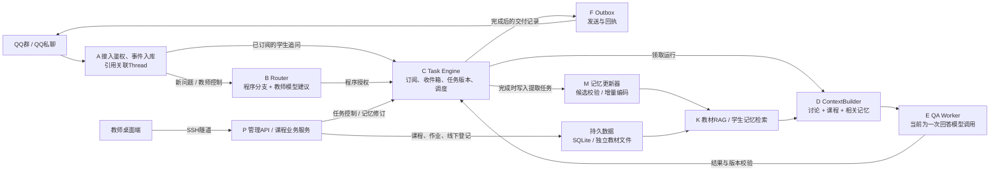

# 当前架构简图、情景流转与 DeepSeek 对照

核对日期：2026-11-04。实现依据为当前源码；服务器配置状态引用2026-11-03最后一次部署记录，本次未重新登录服务器。本文只更新说明，不修改运行系统。

## 判断口径

“已实现”指存在可执行代码及相应验证，不等于已完成真实课程运行验证。最近部署时，模型密钥、匹配的Embedding、助教专属LLBot官方授权均待配置，QQ外发关闭。因此，答疑/记忆的模拟联调成功与真实QQ教学闭环运行是两个不同状态。

比较对象有三层：10月31日设计文章、DeepSeek公开研究原型、本项目。官方README明确说明文章、内部系统和公开代码并不完全一致，文章包含未来方向；不能把文章每个设想当作公开原型已经具备的功能。[官方README](https://github.com/deepseek-ai/dsh-superagent-prototype)

原公众号入口本次无法读取；文章按署名DeepSeek产品部的[中文全文转载](https://www.chaincatcher.com/article/2300676)核对，并与[团队英文文章的中英对照全文](https://aipaper.jasonlin.tech/p/deepseek-super-agent/)交叉阅读。转载页面不作为DeepSeek官网，原型能力以官方仓库文档为准。

## 当前简图

A、C、F及记忆存储都依赖持久数据；为避免线条过多，图中没有画出全部读写箭头。教师修改记忆先更新卡片，再使依赖该版本的任务上下文失效。

QQ通过独立ta-llbot接入。内核在服务器，桌面仅作管理客户端。C内部包含Runner调度：不同任务并发，同任务串行。B本身不是永久保存全局历史的模型Session；学生新问题走程序分支，教师自然语言才调用规划模型。P的结构化编辑直接进入业务服务，不需要先交给Router。

## 已实现情景的节点流动

| 情景 | 节点路径 | 当前行为及边界 |
| --- | --- | --- |
| 学生@机器人提出新问题 | QQ → A → B → C → D（读取K）→ E → C → F → QQ | 按真实作者和课程创建QA任务，回复目标由程序绑定。真实模型和QQ连接仍需配置 |
| 多名学生同时问题 | A分别建立不同Thread → C分别调度 → D/E并行 → F分别交付 | 默认3个Worker槽位；个人记忆按当前提问者隔离。同一Thread内的多人发言仍保留真实作者 |
| 引用原答复继续追问 | QQ → A引用映射 → C订阅收件箱 → D → E → C/F | 后续内容无需教师Router模型转发。执行中出现新输入时，旧输入版本不能提交，随后重建上下文执行；不是在同一个模型调用中途插入新文本 |
| 同一个学生换Thread问相关概念 | A → B → C → D → K（教材知识点与本人历史）→ E | 当前Thread变化不影响学生主体；私人记忆不进入公开答疑。没有相关证据时不会保证召回 |
| 学生指出“这不是刚才那道题” | A → Thread复核 → C归属修订 → 重建D/E | 自动复核需THREAD_RECLASSIFY_ENABLED且模型可用；教师也可从管理API发起。同步失效受影响记忆、旧结果、租约和未发交付 |
| 教师修改、暂停、恢复、取消任务 | QQ → A/B → C，或桌面 → P → C | 更新版本、尽力中止Worker；忽略中止信号的旧结果仍被拒绝。暂停需教师恢复，取消不自动复活 |
| 教师编辑课程进度和作业 | 桌面 → P → 正式记录 | 已支持结构化保存和版本冲突检查。课程变化使相关运行失效；保存作业目前不会向QQ群发布 |
| 教师登记线下作业 | 桌面 → P → 正式提交记录 | 用实际提交时间比较作业截止时间，登记迟交并审计；没有截止提醒 |
| 教师纠正或停用学习记忆 | 桌面 → P → 卡片版本更新 → C → 新D/E | 旧版本读者失效，待发旧结果撤销；历史已发答复保留，不自动重发 |
| 模型故障 / 进程重启 / 发送中断 | C记录状态 → Runtime恢复或教师重试；F记录外发状态 | 进程可由systemd拉起，租约过期回排、记忆任务恢复；普通模型失败会blocked，未实现全面瞬态错误退避重试。发送结果不明标unknown，不自动重发 |
| 学生冒充教师或在材料中夹带指令 | A保留真实身份 → B/C权限检查；材料进入D/E的数据区 | 学生不能创建教师任务或执行控制。程序边界限制操作后果，不能保证模型文字判断永不受注入影响 |

目前A主要用明确引用确定Thread，否则建立新Thread；自动纠错针对特定反馈线索，不是对所有群消息持续语义分类。群内未@且没有已知引用的消息会被接入层忽略，不能据此宣称系统已经持续理解全群讨论。

## 目标业务尚未实现的路径

以下是后续路径，图中的通用任务骨架已经存在，但相应业务Worker和工具尚未完成。

| 情景 | 目标流转 | 当前缺口 |
| --- | --- | --- |
| 教师私聊布置作业并发布 | A → B → C课程事务任务 → 保存作业 → F发布群消息 | Router只支持QA、lesson和任务控制；没有自然语言课程事务Worker及作业发布器。现阶段需桌面保存 |
| 邮件收作业，次数填错 | 邮箱适配器 → 事件 → 作业定位Worker → 查询全部已布置作业 → 附件识别 → 固定标准批改 → 提交结果 → 回复邮件 | 邮箱接入、附件/OCR、作业归属定位、批改Worker、邮件发送均待实现。学生填写次数仅作线索，正常邮件回复应在批改后 |
| 根据学情生成习题课讲义 | C → 教材/课程/作业/往年试卷 → 讲义Worker → 文档渲染 → 教师交付 | 有教材检索和基础数据；尚无完整批改数据、试卷导入、讲义Worker和渲染检查。lesson目前进入blocked |
| 周报/月报与助教系统填报 | 调度触发 → 正式统计 → 报告Worker → 教师审阅/受控系统填报 | 调度器、报告Worker和学校系统连接器尚未实现 |

“截止前提醒”按既定需求不做，不能算待补功能。

## 与文章及公开原型的能力对照

下面“原型”指官方文档明确描述的实现，不代表本次已运行过DeepSeek原型。

| 能力 | 文章与公开原型 | 本项目判断 |
| --- | --- | --- |
| Router / Worker分工 | 原型有主Session和每Ticket独立Executor。[执行文档](https://github.com/deepseek-ai/dsh-superagent-prototype/blob/main/docs/003-execution.md) | 已实现职责分工与并发骨架；目前只有QA实际执行，lesson占位 |
| 常驻Router与全局连续性 | 原型主Session接收候选、跟进与Worker报告，并能读取旧对象。[架构文档](https://github.com/deepseek-ai/dsh-superagent-prototype/blob/main/docs/007-architecture.md) | 部分：Router按次调用，教师规划只带最近20条任务摘要；没有常驻全局Session和Worker报告驱动协调 |
| 事件订阅直达 | 原型多对多订阅，跟进直达Executor，可交回协调层重分派。[领域模型](https://github.com/deepseek-ai/dsh-superagent-prototype/blob/main/docs/001-domain.md) | 核心已实现：Thread订阅、输入去重、追问唤醒。缺少Worker自主订阅、取消订阅和超范围消息交回协议；纠错分类器只补充部分能力 |
| Router批处理 | 原型把同Thread等待Trigger合为下一批评估。[架构文档](https://github.com/deepseek-ai/dsh-superagent-prototype/blob/main/docs/007-architecture.md) | 未实现模型批处理；当前排队/并发与多个输入形成历史不等于批量路由决策 |
| 异步多步Agent Loop | 原型Executor具有文件、shell、后台job、subagent等工具与唤醒机制。[执行文档](https://github.com/deepseek-ai/dsh-superagent-prototype/blob/main/docs/003-execution.md) | 未实现完整工具循环。只有异步任务调度、取消和预检索后单次回答 |
| Inline / Spill | 原型提供有长度限制的对象卡、预览与续读资源。[架构文档](https://github.com/deepseek-ai/dsh-superagent-prototype/blob/main/docs/007-architecture.md) | 部分：已有上下文预算、卡片、父块和证据ID；省略内容尚无Worker工具续读路径 |
| Chain of Recall | 原型工具可沿Trigger、Thread、Ticket、会话内容及关联ID逐跳读取。[架构文档](https://github.com/deepseek-ai/dsh-superagent-prototype/blob/main/docs/007-architecture.md) | 未完整实现。当前是预先安排的教材/记忆RAG，Router和Worker不能自主沿引用图多跳召回 |
| 跨信道推进同一工作 | 原型连接GitHub与可选飞书，并保存工单/Thread/Channel联系。[领域模型](https://github.com/deepseek-ai/dsh-superagent-prototype/blob/main/docs/001-domain.md) | 部分：QQ群、私聊与管理入口共用内核；教师能从管理入口控制任务，但任务输入/交付绑定单一渠道，邮件未接入 |
| 主动发现与提前行动 | 原型有规则、接入表及off/observe/auto模式。[授权文档](https://github.com/deepseek-ai/dsh-superagent-prototype/blob/main/docs/002-authorization.md) | 未实现自主接单规则。完成任务后自动提取记忆不等于主动发现新教学任务 |
| 持久状态与异常恢复 | 原型保存Session、目录、订阅、消息和执行记录，部分瞬态故障退避重试。[执行文档](https://github.com/deepseek-ai/dsh-superagent-prototype/blob/main/docs/003-execution.md) | 基础已实现：SQLite、收件箱、Outbox、租约、重启恢复。缺少完整多步检查点续跑、模型自动退避及系统性故障恢复 |
| 独立Watchdog | 文章提出主系统之外的模型控制回路，判断无进展、偏航并介入。公开原型文档不能据此算作完整实现 | 本项目未实现。systemd和租约回收只能处理部分运行问题，不能判断教学任务是否做对 |
| 云端Loop与多端执行daemon | 文章描述执行环境与Loop进一步解耦；公开原型按Ticket在配置执行根目录中工作 | 本项目未实现跨设备执行。服务器内核+SSH桌面客户端已实现；桌面不是执行daemon，SQLite也尚非独立分布式存储服务 |
| 授权与抗注入边界 | 原型由程序执行Policy/Mandate和工具检查，外部文字不能修改授权。[授权文档](https://github.com/deepseek-ai/dsh-superagent-prototype/blob/main/docs/002-authorization.md) | 核心原则已实现：真实QQ身份、教师控制权限、范围及版本检查。没有完整原型Policy规则体系，也不能声称消灭语义注入 |
| 人工介入与低打扰面板 | 原型面板优先显示需人工处理的工作、健康问题和历史。[面板文档](https://github.com/deepseek-ai/dsh-superagent-prototype/blob/main/docs/005-panel.md) | 部分：课程、任务、线下登记、记忆和QQ状态页面；缺少统一“需要教师决策”的结构化队列和交付审阅流程 |
| 长程记忆 | 文章将跨月记忆、扩展规模及安全等列为开放问题 | 已增加学生学习卡片、来源依赖与RAG，属于领域扩展；不能据此认定已经解决全局长程记忆 |

对照文章的四个目标，当前为：连续性部分实现；高效性具备并发与直达骨架，尚未验证复杂任务吞吐；主动性尚未实现；持久性有基础恢复，缺少语义Watchdog。

thread可修正、学生卡片及教材RAG属于本项目的助教领域设计，不是照搬公开原型的功能承诺。

## 源码核对入口

- 接入、过滤与引用关联：src/adapters/qq/llbot.ts。
- Router：src/agents/router.ts。
- 任务、版本、订阅、恢复：src/application/task-engine.ts。
- Runtime与并发：src/application/runtime.ts、src/application/task-runner.ts。
- 上下文与一次回答：src/agents/context-builder.ts、src/agents/workers/qa-worker.ts。
- 记忆与检索：src/application/memory-updater.ts、src/application/services/memory.ts、src/adapters/knowledge/library.ts。
- 正式业务：src/application/services/academics.ts。
- 外发：src/application/delivery-outbox.ts。
- 最后部署状态：docs/deployment-memory-2026-11-03.md。

最近一次验证为后端57项、桌面7项；它们验证程序行为，不证明真实模型教学效果或与原文实验相同的性能。本次仅文档更新，未重复运行无变化代码的测试。
