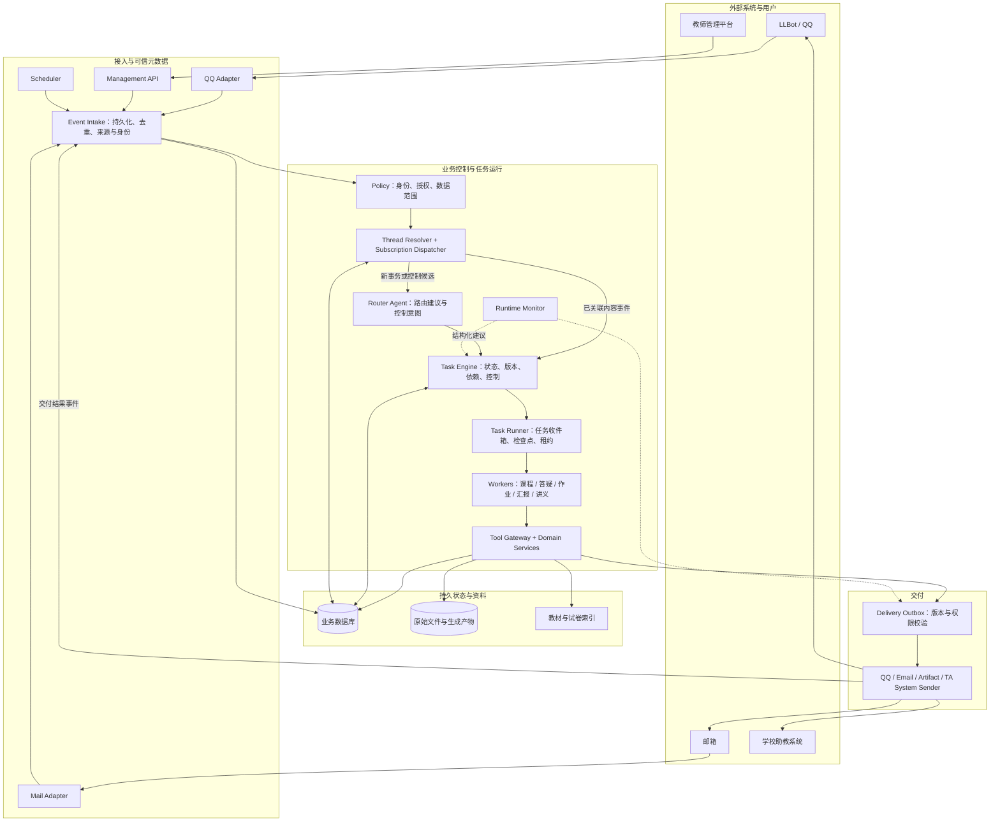
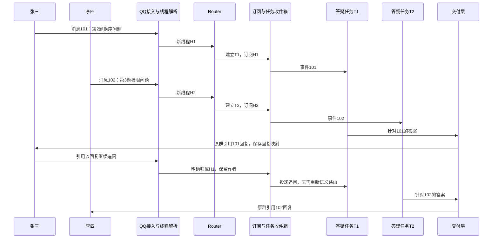
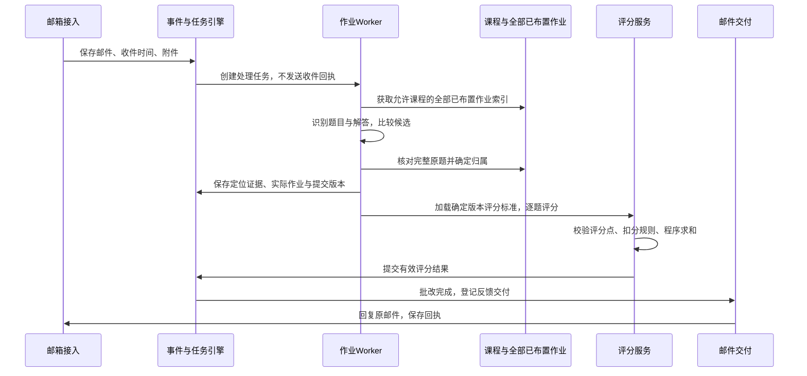
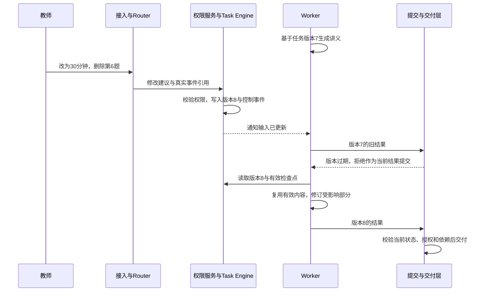

# 助教 Super Agent：架构与项目文件规划

版本：0.3（增加学习记忆与教材RAG接入）  
日期：2026-11-03  
状态：运行骨架、基础答疑、学习记忆和教材预检索已实现；记忆架构、来源修订及实现范围见[学习记忆与教材RAG](memory-rag.md)，其余完整目标仍按阶段推进。  
项目定位：从零创建独立系统，LLBot 仅作为 QQ 通信服务。

## 1. 目标与已确定约束

目标是持续承接课程助教的主要工作，使教师以自然语言安排教学事务，系统自主完成执行、记录和交付，教师处理教学决策和必要例外。

| 范围 | 确定的行为 |
| --- | --- |
| QQ | 通过已有 LLBot 服务接入；新建自己的消息适配器、Agent 与业务层 |
| 教师安排 | 教师可通过私聊设定课程进度、布置作业、修改要求、暂停或取消任务 |
| 答疑 | 群内多学生并发提问；按讨论线程订阅后续消息；独立任务上下文 |
| 作业评分 | 每次强制加载适用的课程评分标准和本次作业评分细则 |
| 邮件提交 | 保存后定位实际作业、批改；正常情况在批改完成后回复，不发送收件回执 |
| 次数填错 | 学生填写次数仅作线索；Worker 可检索本课程全部已布置作业，自主核对归属 |
| 学生识别 | 按邮件姓名、群内人名备注识别；不建设 QQ—邮箱—姓名绑定系统 |
| 线下提交 | 平台登记；提供扫描件可自动批改，也可录入人工批改结果 |
| 截止处理 | 不作截止提醒；按实际收件或实际线下提交时间判定迟交 |
| 汇报 | 基于实际业务记录生成周报、月报，并写入助教系统 |
| 讲义 | 综合教材、实际课程进度、作业表现、答疑难点和往年试卷编制 |
| 运行 | 服务重启后恢复待办任务；耗时任务不阻塞教师对话和其他学生答疑 |

首版不做学生账号体系、跨渠道身份绑定、多级 Agent 组织或微服务集群。班级应交名单可按姓名导入，用于缺交统计。姓名用于业务归档，不代表管理权限或私人信息访问权限。

## 2. 核心架构决策

1. **事件驱动**：QQ、邮件、平台、时间和执行结果统一转为持久事件。
2. **Router 轻量协调**：理解新要求、提出任务创建和修改建议，不亲自执行批改、备课等长任务。
3. **任务独立**：每个具体工作拥有自己的状态、上下文、输入收件箱和权限范围；Worker 是任务角色，不是全局共享聊天记录。
4. **订阅持续跟进**：已关联的后续事件直接进入任务；订阅只传递内容，不授予修改任务或执行管理操作的权限。
5. **程序维护正式状态**：课程安排、任务状态、评分标准、成绩和交付记录存数据库；聊天总结不作为正式规则来源。
6. **版本控制执行**：修改产生新版本；过期执行结果不能写入当前正式状态或发出。
7. **权限由服务强制执行**：模型提出动作，业务工具按可信来源、任务授权和当前版本校验。
8. **独立开发**：可沿用成熟工程方法，但不复用 AI-chat 源码、全局记忆、数据目录或运行入口。

## 3. 总体架构



图中 Policy 不是一次性筛选器。创建任务、订阅投递、工具调用、恢复任务、最终交付时，均校验对应的权限和状态。

## 4. 部署与模块边界

当前确定采用**服务器内核＋独立Electron桌面端**。桌面通过IP、SSH用户名和密码建立加密通道，访问服务器本机管理API；页面支持课程编辑与线下登记。下面原有Web界面规划的职责由桌面renderer承担，部署与实际文件结构见 [服务器与桌面架构](desktop-server.md)。

推荐首版采用 TypeScript、单仓库模块化后端、独立 Web 管理界面、SQLite 业务数据库和文件存储。具体依赖版本在实施阶段锁定。

- 后端内部运行接入、Router、任务调度与交付循环；任务按逻辑隔离上下文，不要求首版为每个任务启动操作系统进程。
- LLBot、邮箱、模型服务、学校助教系统均是外部依赖，通过端口接口适配。
- 桌面renderer通过受限IPC调用主进程，后者经SSH调用Management API，不直接访问数据库或拥有模型工具权限。
- Agent 不直接持有数据库连接、外部凭据或服务器 Shell。工具网关提供业务级操作。
- 数据库、原始文件、生成产物构成持久状态。模型上下文可以销毁后重新构造。
- SQLite 访问集中在后端；未来若扩为多主机并发，替换存储适配器，不直接共享数据库文件。

## 5. 核心领域对象

| 对象 | 核心信息 | 约束 |
| --- | --- | --- |
| Course | 学期、班级、教材、实际与计划进度、群号、课程规则 | 规则与进度有版本 |
| StudentEntry | 课程/班级、姓名、必要消歧信息 | 用于归档；不承载跨渠道登录身份 |
| Assignment | 正式 ID、题目、教材位置、选做要求、发布时间、截止时间 | 保存历次修订，不根据邮件次数覆盖 |
| Rubric | 通用评分标准、本次逐题细则、版本、适用范围 | 批改必须绑定确定版本 |
| Submission | 原邮件、姓名、填写次数、实际作业、文件、收件时间、提交版本 | 原始信息与系统归属分别保存 |
| Grade | 提交版本、评分标准版本、逐评分点结果、证据、总分、修订原因 | 总分由程序计算 |
| Thread | 具体讨论的事件序列、根消息、参与者 | QQ 群不是默认答疑线程 |
| Subscription | 任务、线程或业务主题、事件类型、用途、游标 | 区分讨论续接与只读参考；不传递授权 |
| Task | 目标、角色、版本、状态、依赖、输入与检查点 | 独立于一次模型调用 |
| TaskGrant | 发起依据、课程范围、可读写资源、工具、交付范围 | 程序生成并校验，模型不能修改 |
| Event | 来源、真实作者、原文引用、时间、关联资源 | 不可变；可信元数据与正文分离 |
| Delivery | 任务版本、目标渠道、正文/文件、发送状态、外部回执 | 目标来自业务上下文，不能任意改写 |
| ActivityRecord | 已完成业务动作、周期、关联对象、可核实工作量 | 为汇报提供事实依据 |

姓名重名或缺失时只处理该条异常，不要求全班预绑定账号。教师 QQ ID 和后台角色属于权限配置，与学生姓名归档完全分开。

## 6. 事件与路由契约

### 6.1 事件信封

以下为逻辑结构；正式类型在实施时定义。

```typescript
type EventEnvelope = {
  id: string;
  source: 'qq' | 'mail' | 'web' | 'scheduler' | 'internal';
  sourceEventId: string;
  occurredAt: string;
  receivedAt: string;
  actor: { sourceIdentity: string; role: 'teacher' | 'student' | 'system' | 'unknown' };
  kind: string;
  threadId?: string;
  resourceRefs: string[];
  payloadRef: string;
  causationId?: string;
};
```

`actor` 由受信任适配器和权限服务生成，不从正文提取。`payloadRef` 指向不可信正文或附件。内部事件同样保留因果链，不因“由 Worker 生成”而自动成为教师指令。

### 6.2 路由路径

```text
接入事件 → 持久化与去重 → 来源校验 → Thread/资源关联
  ├─ 已关联内容 → 订阅投递 → 任务收件箱
  ├─ 新事务 → 有限上下文 Router → 创建任务建议 → Engine 授权后创建
  ├─ 教师控制候选 → Router 解析目标与动作 → Engine 授权并修改
  └─ 无关内容 → 记录或忽略
```

模型给出的任务 ID、课程 ID、作者角色等均需服务校验。无法确定关联时不猜测；询问必要信息或保持为待定位任务。

Router 按次构造有限上下文，读取必要任务摘要和正式记录；不长期累积全群原文、邮件附件和所有 Worker 推理。

## 7. 订阅与并发答疑

### 7.1 线程归属

关联优先级：明确消息引用及已保存的回复映射 → 明确题目与讨论关系 → 同一作者近期讨论的语义候选。存在多个合理候选时澄清。

线程可多人参与，但所有事件保留真实作者。其他学生引用同一答疑可以加入该线程，其权限不会因此升级。一个线程可关联多个任务；投递记录保证同一事件不会在同一任务重复处理。

### 7.2 隔离与交付

线程归属允许根据后续反馈修正，明确引用也不是不可推翻的判定。消息原文与身份不可变，当前归属单独版本化。拆分或合并通过受控事务重建受影响的答疑上下文、失效旧结果并更新引用映射，不改写教师业务授权。详见 [可修正的Thread分类](thread-routing.md)。



- 同一任务的执行回合串行，独立任务可并发；批改与备课不占用 QQ 会话长锁。
- Worker 只读取本线程及必要资料；邻近群消息作为有来源的参考材料按需读取。
- 回复工具绑定被回答事件，程序解析群号、引用 ID 与对象。模型不自由填写接收 QQ。
- 新输入到达时进入持久收件箱；下一个检查点消费。答复记录其覆盖的输入游标，避免遗漏执行期间到达的追问。
- 已完成答疑可在有效权限下因明确追问恢复；已取消任务不自动复活。
- 不同学生共享同一讨论时，程序防止上下文和接收对象混用；语义关联仍可能出错，因此含混关联需澄清。

## 8. 业务路径

### 8.1 教师更新课程与发布作业

```text
教师私聊 → 来源身份校验 → Router → 课程事务任务
→ 读取默认规则、教材和课程 → 补全并校验要求
→ 保存课程/作业新版本 → 登记交付 → LLBot 发布
→ 保存回执 → 向教师反馈
```

只有缺少不能推断的关键内容时询问教师。教师要求定时发布时创建持久时间计划。发布失败保留正式记录与失败状态，不谎报已发布。

本次评分细则可在发布后并行准备；批改开始前必须存在适用细则。是否逐次由教师审阅细则是课程配置，不预设重复确认。

### 8.2 事务答疑与知识答疑

教材确定采用 **BM25关键词召回 + 向量语义召回 + RRF融合 + 父子块扩展**，并提供题号/定理编号精确定位与原页核对。兼容导入已有教材包；模型与索引配置须一致。详见 [教材RAG设计](textbook-rag.md)。

```text
事务问题 → 查询课程/作业正式记录 → 回答原消息
知识问题 → 答疑任务 → 关联原题 → 加载实际进度与答疑策略
→ 限权教材工具 → 编号精确定位或RAG混合检索
→ 原文/原页核对 → 推理与检查 → 公式渲染 → 回答原消息
→ 记录知识点与共性难点
```

答疑策略决定未截止作业提供提示还是完整解答。学生消息和聊天记忆不能改变该策略。

### 8.3 邮件提交、实际作业定位、批改与最终回复



定位要求：

- 学生填写的次数仅作线索；先核对所填作业，不符则检索本课程其他全部已布置作业。
- 作业索引包含题目、教材版本、页码、章节、小问和补充要求；读取索引后按需加载完整候选，不把所有附件一次塞进上下文。
- 按题目内容、结构、教材位置与解答证据匹配，不能仅凭相同题号认定。
- 跨课程候选仅限任务被授权读取的课程；课程也不明确时先定位或澄清。
- 一封邮件包含多次作业可拆分记录；实际归属与学生原始填写分别保留。
- 多个候选内容相同或证据不足时，进入待澄清状态，不强制挑选一个。
- 正常情况完成本邮件可处理内容后统一回复；损坏、缺页或归属不明等阻塞情况可发送必要补充请求。
- 回复可说明次数修正及登记结果；不发送正常收件回执。

### 8.4 评分标准与逐题批改

```text
通用评分标准 + 本次作业细则
→ 绑定标准版本 → 原件识别与分题 → 逐评分点判断
→ 证据与实得分 → 程序校验、求和 → 疑点复核
→ 保存正式结果 → 反馈原提交渠道
```

标准规定满分、步骤分、替代解法、典型扣分、重复扣分限制与错误传递处理。迟交扣分按课程配置执行。模型不能输出任意总分代替评分点计算。

识别不清的题保留原图定位，不将 OCR 失败直接判为学生错误。认可样例用于评分校准；结构化标准不能保证模型评判绝对一致，需要真实样例验证。

修改标准需明确适用范围：后续作业或重评指定作业。重评保留旧评分，生成新版本并标记统计更新。

### 8.5 线下登记与迟交

```text
教师平台勾选姓名/批量登记 → 校验课程与作业 → 保存实际提交时间
→ 登记线下已交 → 计算迟交 → 更新提交统计
  ├─ 有扫描件 → 文件处理 → 自动批改
  ├─ 有人工成绩 → 保存人工评分与来源
  └─ 仅登记 → 保留已交、未批改状态
```

邮件迟交依据邮箱接收时间和实际定位作业的截止时间，不使用邮件正文自述日期、批改时间或任务执行时间。线下补录允许教师填写实际提交时间，并保留操作时间与操作者。

不创建截止提醒，也不因截止主动向学生发消息。缺交统计在教师查询、汇报或备课需要时计算；截止后仍接收并标记迟交。

### 8.6 重交与申诉

```text
重交邮件 → 定位课程/姓名/作业 → 按课程规则建立提交新版本
→ 更新有效版本 → 批改 → 最终反馈

回复批改邮件申诉 → 关联原邮件与评分 → 复核任务
→ 核对原件、标准和申诉 → 修订或维持 → 回复 → 更新统计
```

原件和旧结果不覆盖。批改时绑定提交版本；新版本生效后，旧任务不能发布过期结果。不同来源声称同一姓名时，不仅凭姓名覆盖他人有效提交或访问私人反馈，必要时列为异常由教师处理。

### 8.7 周报与月报

```text
周期事件/教师指令 → 汇报任务 → 查询周期内真实业务与工作记录
→ 计算数量并组织说明 → 生成结构化报告与附件
→ 助教系统适配器填报 → 读取并核对保存结果 → 记录回执
```

月报从底层活动去重汇总，不简单拼接周报。工时使用教师确定的记录规则，不以后台运行时间替代。表单草稿与正式提交在适配器中分别记录，具体自动提交权限由教师预设。

### 8.8 习题课讲义

```text
教师指令/备课时间事件 → 讲义任务
→ 实际课程进度 + 作业学情 + 答疑难点 + 教材与往年试卷
→ 教学目标与时间分配 → 选题/改编 → 求解验证
→ 学生版与教师版 → 渲染检查 → 交付教师
```

可先处理教材与试卷，同时订阅批改完成事件，再补学情分析。最终记录统计覆盖范围。学生版与教师版分别标注交付类型，教师版答案不进入学生版发布任务。

## 9. 修改、暂停与取消

### 9.1 控制路径



控制消息不经过长任务的执行队列。修改由 Engine 持久化，再通知 Worker；通知丢失也能通过下一步查询版本发现。

### 9.2 三种控制语义

| 动作 | 程序行为 |
| --- | --- |
| 修改要求 | 增加任务版本，记录影响范围；失效相关检查点，保留可复用产物 |
| 暂停 | 禁止安排后续执行和未发交付；尽力取消在途调用，保存检查点 |
| 取消 | 终止本次授权工作，停止订阅唤醒；新工作需新建任务 |

模型调用和工具调用使用取消信号，但取消不能保证远端立刻停止。即使旧调用返回，提交服务仍检查任务版本、执行租约、任务状态和依赖版本。

发送与取消在本地由同一协调规则排序：取消先提交时，未领取发送授权的交付停止；已经进入外部发送中的操作可能完成。此类操作保留真实回执，取消不宣称撤回已发邮件。

修改评分标准、作业要求等共享资源，会通过依赖记录找到受影响任务；不能只向当前聊天中的一个 Worker 发消息。

## 10. 权限与提示词注入防护

### 10.1 身份与授权

- 教师身份依据受信 LLBot 连接中的实际 QQ ID 和后台登录身份；昵称、人名备注、正文、自称、引用、转发均不授予权限。
- LLBot 到后端的连接必须受访问控制，防止外部伪造事件；若接入服务或教师账号本身失陷，身份判断基础也随之失效。
- 作业邮件触发批改的依据是教师预设业务规则；邮件正文不具有教师控制权限。
- TaskGrant 由服务依据可信事件和政策生成，记录可读写资源、工具、交付范围与发起依据。
- 每次敏感工具调用、任务恢复和交付重新校验当前授权。教师撤权或暂停需阻断后续操作。
- 直接订阅投递也经过状态与内容访问检查；不能借由订阅绕过工具授权。

### 10.2 权限矩阵

| 主体/任务 | 可用能力 | 不授予的能力 |
| --- | --- | --- |
| 学生群消息 | 提问、追加讨论材料 | 修改规则、成绩、任务目标、发布对象 |
| 学生邮件 | 提交、补材料、针对原批改申诉 | 改评分标准、群发、读取他人成绩 |
| 教师 | 管理授权课程的安排、标准和任务 | 默认不越过其授权课程范围 |
| 答疑任务 | 读取相关教学资料、回复关联消息 | 读取全班私人原件、修改成绩 |
| 作业任务 | 检索允许课程全部已布置作业、读取本提交、保存评分建议 | 任意改正式作业、任意读取其他提交、修改标准 |
| 讲义任务 | 教学资料、必要学情、生成讲义 | 任意发布教师答案、修改成绩 |
| 汇报任务 | 周期工作记录、统计、指定系统填报 | 任意读原始私人附件、修改课程政策 |

私人反馈沿原提交邮件返回。群备注或新邮件中的同名声明不用于取得他人私人结果。成绩数据读写由任务上下文绑定，不能通过模型传入任意姓名或 task_id 切换范围。

### 10.3 防污染路径

```text
可信控制路径：教师实际身份 → 意图解析 → 授权检查 → 正式状态修改
不可信内容路径：消息/邮件/附件 → 有来源的数据 → 限权Worker → 结构化结果
```

1. 身份、权限、任务授权保存在程序对象中，不由模型正文定义。
2. 学生内容、教材、检索结果和 OCR 文本始终标为材料；嵌入其中的指令不成为控制操作。
3. Router 使用按次构造的上下文；附件默认在 Worker 处理，不汇入全局常驻记忆。
4. Worker 回报优先为状态、资源 ID、异常类型；自由文字总结保留来源，不自动变成规则或授权。
5. 模型无任意 Shell、SQL、服务器文件读取、通用群发等工具；敏感凭据由适配器持有。
6. 正式评分规则、课程政策和权限只允许授权服务修改，自动聊天总结不可覆盖。
7. 交付校验目标、任务版本、产物归属与可见级别；学生版发布不能携带教师版文件或他人附件。

不宣称模型永不受提示词注入影响。架构目标是减少不可信内容进入控制上下文，并用程序边界限制被误导后的操作后果。内容级错误仍需评估与异常处理。

## 11. 持久化、恢复与完成判定

建议的逻辑表：

```text
courses, course_revisions, class_roster
assignments, assignment_revisions, rubrics
submissions, submission_versions, assignment_matches
grades, grade_items, grade_revisions
events, threads, thread_events, reply_links, subscriptions
tasks, task_grants, task_inputs, task_dependencies, task_checkpoints, task_runs
scheduled_jobs, deliveries, delivery_attempts
artifacts, activity_records, report_records
```

- 正式记录变更与后续事件/待交付登记在同一数据库事务中完成，避免业务已完成却丢失后续处理。
- 事件、任务输入与交付使用稳定标识去重；系统重启重放不重复登记提交或成绩。
- Runner 使用任务租约和执行编号；旧执行实例失去租约后不能提交结果。
- 每题批改、资料准备、讲义提纲等阶段保存检查点；重启从有效步骤恢复。
- 监控检查超时、连续失败、待澄清与交付异常；不能通过绕过授权来“修复”任务。
- 外部调用超时可能已发送成功，应查询可用回执或标记结果待核对，不盲目重发。
- 完成需区分业务结果已保存与外部交付成功。交付未完成时界面如实显示。

## 12. 项目文件规划

以下为完整目标目录，部分目录已实施，实际范围见 [实现说明](implementation.md)；其余目录按业务接入逐步创建，不以空文件冒充实现。

```text
ta-super-agent/
├─ README.md
├─ package.json                    # 开发、构建、运行、验证入口
├─ tsconfig.json
├─ .env.example                    # 配置名称示例，不包含实际凭据
├─ .gitignore
├─ docs/
│  ├─ architecture.md              # 本文：整体架构与业务路径
│  ├─ contracts.md                 # 事件、工具、状态机、交付契约
│  ├─ grading-policy.md            # 评分配置与版本规则
│  ├─ operations.md                # 部署、恢复、异常处理
│  └─ decisions/                   # 重大设计决策记录
├─ config/
│  ├─ app.example.yaml             # 外部服务、资源目录、运行参数
│  └─ policies.example.yaml        # 教师授权、课程能力、交付规则
├─ src/
│  ├─ main.ts                      # 组合根；装配依赖、启动/关闭
│  ├─ config/                      # 读取、校验配置
│  ├─ domain/
│  │  ├─ course.ts
│  │  ├─ assignment.ts
│  │  ├─ rubric.ts
│  │  ├─ submission.ts
│  │  ├─ grade.ts
│  │  ├─ event.ts
│  │  ├─ thread.ts
│  │  ├─ subscription.ts
│  │  ├─ task.ts
│  │  ├─ grant.ts
│  │  └─ delivery.ts
│  ├─ ports/
│  │  ├─ repositories.ts           # 数据持久化接口
│  │  ├─ model.ts                  # 模型调用接口
│  │  ├─ channels.ts               # QQ、邮件、系统填报接口
│  │  ├─ knowledge.ts              # 教材与试卷检索接口
│  │  └─ files.ts                  # 文件与产物接口
│  ├─ application/
│  │  ├─ intake.ts                 # 来源、去重、事件入库
│  │  ├─ thread-resolver.ts        # 引用、题目与讨论归属
│  │  ├─ subscriptions.ts          # 订阅、投递、输入游标
│  │  ├─ task-engine.ts            # 创建、状态转换、依赖
│  │  ├─ task-control.ts           # 修改、暂停、恢复、取消
│  │  ├─ task-runner.ts            # 租约、步骤、取消信号
│  │  ├─ scheduler.ts             # 定时发布、汇报、备课
│  │  ├─ delivery-outbox.ts        # 校验、领取发送、回执
│  │  ├─ runtime-monitor.ts        # 卡住、失败与恢复
│  │  └─ services/
│  │     ├─ courses.ts
│  │     ├─ assignments.ts
│  │     ├─ submissions.ts
│  │     ├─ grading.ts             # 标准绑定、分数校验、求和
│  │     ├─ statistics.ts          # 缺交、迟交、学情等计算
│  │     ├─ reporting.ts
│  │     └─ artifacts.ts
│  ├─ agents/
│  │  ├─ router.ts                 # 输出路由/控制建议
│  │  ├─ context-builder.ts        # 按任务与权限构造上下文
│  │  ├─ worker-loop.ts            # 通用执行循环与检查点
│  │  ├─ result-schemas.ts         # 结构化输出校验
│  │  └─ workers/
│  │     ├─ course-worker.ts
│  │     ├─ qa-worker.ts
│  │     ├─ homework-worker.ts
│  │     ├─ report-worker.ts
│  │     └─ lesson-worker.ts
│  ├─ tools/
│  │  ├─ gateway.ts                # 执行时授权、版本、参数校验
│  │  ├─ catalog.ts                # 各角色可用工具声明
│  │  ├─ course-tools.ts
│  │  ├─ submission-tools.ts
│  │  ├─ grading-tools.ts
│  │  ├─ knowledge-tools.ts
│  │  ├─ artifact-tools.ts
│  │  └─ delivery-tools.ts
│  ├─ security/
│  │  ├─ principals.ts             # 可信来源到主体/角色
│  │  ├─ policy.ts                 # 操作与资源范围判定
│  │  ├─ grants.ts                 # 任务授权生成与重验证
│  │  └─ provenance.ts             # 材料来源与可信度标注
│  ├─ adapters/
│  │  ├─ qq/llbot.ts               # 全新QQ适配器
│  │  ├─ mail/receiver.ts
│  │  ├─ mail/sender.ts
│  │  ├─ models/client.ts
│  │  ├─ storage/sqlite.ts
│  │  ├─ storage/repositories/     # ports中仓储接口的实现
│  │  ├─ storage/file-store.ts
│  │  ├─ knowledge/library.ts
│  │  ├─ documents/extractor.ts    # PDF/图片等内容提取
│  │  ├─ documents/renderer.ts     # 讲义、反馈产物渲染
│  │  └─ ta-system/connector.ts    # 学校系统适配与结果核对
│  ├─ http/
│  │  ├─ server.ts
│  │  ├─ auth.ts
│  │  └─ routes/                  # 课程、提交、任务、规则、产物
│  └─ telemetry/                  # 任务日志、模型用量、错误记录
├─ prompts/
│  ├─ router.md
│  ├─ common/                     # 数据来源、输出与角色约束
│  └─ workers/                    # 各Worker的业务执行说明
├─ web/                           # 独立教师管理界面
│  └─ src/
│     ├─ pages/                   # 待办、作业、登记、评分、讲义、汇报
│     ├─ components/
│     └─ api/
├─ migrations/                    # 数据库迁移
├─ tests/
│  ├─ unit/                       # 状态机、评分计算、授权
│  ├─ integration/                # 业务事务与适配器契约
│  ├─ scenarios/                  # 并发答疑、重交、打断、恢复
│  ├─ evals/                      # 作业定位、评分、注入样例评测
│  └─ fixtures/                   # 合成/去标识材料，不提交真实隐私
├─ scripts/                       # 数据导入、备份、管理命令
├─ deploy/                        # 服务启动、代理、部署配置
└─ var/                           # 本地运行目录，忽略版本控制
   ├─ db/
   ├─ originals/
   ├─ artifacts/
   ├─ indexes/
   └─ logs/
```

### 12.1 依赖方向

```text
domain：纯领域类型与规则，不依赖Agent或外部服务
ports：对存储、模型、渠道等能力的接口
application：依赖domain和ports，编排正式业务
security：提供程序授权与来源校验
agents：读取允许上下文，调用tools，不直接写库或外发
tools：调用application服务，同时执行security检查
adapters：实现ports，处理外部协议
http：认证请求后调用application
main：装配全部实现
```

Worker 文件只负责该类任务的判断与步骤，不把邮件协议、SQL、权限判定和文档渲染重复写入每个 Worker。提示词说明业务行为，不承担唯一权限防线。

### 12.2 业务与文件映射

| 业务 | 核心路径 |
| --- | --- |
| QQ答疑与追问 | llbot → intake → thread-resolver → subscriptions/router → qa-worker → knowledge-tools → delivery-outbox |
| 教师布置与修改 | llbot/http → principals → router → task-control/courses/assignments → course-worker |
| 邮件作业 | receiver → intake → homework-worker → submission-tools → grading-tools → delivery-outbox → sender |
| 实际作业定位 | homework-worker → knowledge-tools/assignment查询 → submissions保存匹配证据 |
| 线下登记 | http routes → submissions → statistics；有原件再创建homework任务 |
| 标准与成绩 | grading服务 → rubric/grade仓储；模型仅提出逐评分点结果 |
| 周月汇报 | scheduler/router → report-worker → reporting → ta-system connector |
| 习题课讲义 | scheduler/router → lesson-worker → knowledge/statistics → renderer → artifacts |
| 修改与暂停 | intake/http → policy → task-control → task-runner → gateway/outbox版本检查 |

## 13. 实施顺序与验收

| 阶段 | 实现范围 | 必须证明的行为 |
| --- | --- | --- |
| A：运行骨架 | 独立工程、事件入库、权限、Task Engine、Runner、订阅、交付队列 | 两任务并发而各自串行；重启恢复；非教师不能修改；旧版本结果不能提交 |
| B：课程与答疑 | 教师配置、作业发布、教材检索、QQ线程与公式产物 | 多人交错提问不混用上下文和回复目标；引用追问直达原任务 |
| C：收改闭环 | 邮箱、线下登记、作业定位、标准化批改、最终反馈、申诉 | 次数填错仍正确匹配；正常不发收件回执；迟交用原收件时间 |
| D：讲义与汇报 | 试卷索引、学情、双版本讲义、周期汇报、学校系统适配 | 可追溯数据来源；教师版不误发；填报核对；中途修改影响正确任务 |

关键场景验证：

1. 同群三位学生交错提问，其中一人同时讨论两题；引用与含混追问分别处理。
2. 作业次数写错、两次题目相同、一邮件多次作业、重交发生在旧批改执行中。
3. 评分标准更新时旧任务正在生成结果；旧成绩与反馈不能作为新结果发出。
4. 教师暂停时模型调用未结束、文件已生成、邮件已进入发送，分别验证边界。
5. 作业附件、群消息、教材片段含伪造教师指令；不能改标准、越权读数据或改变收件人。
6. 学生引用教师消息、伪造角色字段、通过订阅追加越权要求；真实权限不升级。
7. 重启、事件重放、外发超时；不重复登记，不把未知发送结果直接视为失败重发。

## 14. 实施前待补充的业务参数

这些参数不改变架构，可在相应阶段配置或接入时确定：

- 实际课程、教材与试卷格式、作业样例和教师评分样例。
- 本次评分细则是否默认自动生效，以及重交、迟交、选做的具体规则。
- LLBot连接方式、邮箱协议、学校助教系统页面或接口。
- 线下作业是否扫描、反馈文件格式、讲义默认版式。
- 同班重名、材料始终无法定位等例外的教师处理方式。

## 15. 参考

架构沿用已讨论的 Router/Worker、事件、订阅与授权分离思路；本文中的课程领域、版本控制、目录与业务规则为本项目设计，并非声称 DeepSeek 原型已实现这些能力。

- [DeepSeek Super-agent 官方原型](https://github.com/deepseek-ai/dsh-superagent-prototype)
- [官方领域模型与订阅语义](https://github.com/deepseek-ai/dsh-superagent-prototype/blob/main/docs/001-domain.md)
- [官方授权语义](https://github.com/deepseek-ai/dsh-superagent-prototype/blob/main/docs/002-authorization.md)
