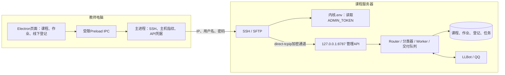

# 服务器内核与桌面工作台

日期：2026-11-02。当前交付包含独立Electron桌面端、SSH适配器、课程/作业编辑与线下登记API、专属LLBot登录管理和Linux服务配置；内核已部署，第二套LLBot待独立Auth Token。当前实例绑定以[双实例记录](dedicated-llbot.md)为准。

## 部署边界



桌面端不复制内核、不在本机启动Worker、不直接编辑SQLite，也不依赖共享本地文件。课程数据只在服务器持久保存。SSH断开时页面要求重连，内核继续运行。

## 连接过程

1. 输入IP、SSH用户名、密码；默认SSH端口22，目录 `<TA_SERVER_DIR>`，API端口8787。
2. 校验服务器主机指纹。首次询问，已知指纹变化则拒绝自动接受。
3. SSH认证成功后，经SFTP读取指定目录 `.env` 中的ADMIN_TOKEN与实际PORT，不执行远程Shell命令。
4. 通过SSH `direct-tcpip` 访问服务器127.0.0.1的API，验证健康状态和管理权限。
5. 页面通过受限IPC发起业务请求；地址、方法与路由由主进程检查。

不开放额外本地代理端口。密码和API令牌只在会话内存中使用，断开清空；本机配置仅保存非敏感连接信息和主机指纹。Electron页面关闭Node集成，使用上下文隔离与沙箱，只加载本地资源；不把不可信文本当HTML执行。

当前SSH账号能管理本服务的全部课程。尚未实现按SSH账号划分教师课程或多人登录角色；需要此能力时在服务端扩展授权，不依据页面传来的姓名授予权限。

## 页面与业务路径

| 页面 | 操作 | 服务端路径 |
| --- | --- | --- |
| 总览 | 课程人数、作业、线下提交、任务数量 | GET课程、作业、登记和任务 |
| 课程设置 | 名称、班级、QQ群、进度、说明、标准、名单 | POST/PUT课程 → 版本校验 → 保存与审计 |
| 作业管理 | 题目、截止时间、本次评分标准 | POST/PUT作业 → 版本校验 → 保存 |
| 线下登记 | 批量登记、补录、时间更正、撤销 | POST/DELETE登记 → 逐记录版本校验 → 事务保存 |
| 运行任务 | 查看状态与结果 | GET任务 |
| LLBot登录 | 在线检测、离线二维码刷新 | 桌面主进程经SSH读取LLBot管理凭据，访问固定登录接口 |

课程改动会失效运行中QA任务的旧上下文，已完成历史答案不会仅因编辑课程而重新群发。教材标识保留在课程数据中，但本轮未实现教材检索与上传界面。

线下登记保存实际提交时间与登记操作时间。迟交用实际提交时间和截止时间比较；截止时间修改时重算迟交状态，不创建提醒。登记只表示纸质作业收到，不产生自动成绩。

评分标准当前支持编辑和保存；自动评分尚未实现。本次作业标准独立保存，之后修改课程通用标准不会静默覆盖已经建立的作业细则。

## Linux服务器部署

推荐固定目录 `<TA_SERVER_DIR>`，Node.js >=24.15。桌面端首版不自动安装或修改服务器服务。

管理员准备：

1. 将仓库的 `src/`、`migrations/`、`package.json` 与实际 `.env` 放到上述目录。当前内核运行时只有Node内置依赖；开发测试需要另外安装开发依赖。
2. 创建服务账号ta-agent，将目录和var数据目录交给该账号；在 `.env` 配置不同的ADMIN_TOKEN、QQ_WEBHOOK_TOKEN，以及模型和LLBot参数。
3. 保持 `HOST=127.0.0.1`、`PORT=8787`。桌面通过SSH访问，无需对公网开放8787。
4. 按实际Node路径、账号和目录核对 `deploy/ta-super-agent.service`，再由管理员安装到systemd。
5. SSH登录账号需要允许TCP转发至实际内核端口，具有SFTP与读取 `.env` 的权限。指定服务器使用<TA_SERVER_KERNEL_PORT>，8787已属于旧面板，不能占用。

示例操作由管理员在服务器执行，本轮未执行：

```sh
sudo cp <TA_SERVER_DIR>/deploy/ta-super-agent.service /etc/systemd/system/
sudo systemctl daemon-reload
sudo systemctl enable --now ta-super-agent
sudo systemctl status ta-super-agent
```

如果计划使用该示例，同时上传deploy目录。通过 `journalctl -u ta-super-agent` 检查运行日志；关闭桌面端不影响systemd服务。其他目录和Node路径应同时修改服务配置与桌面高级设置。

## 新增接口

均要求ADMIN_TOKEN。新增数据经migration003持久保存，已有课程默认从版本1开始。

```text
GET    /v1/courses
POST   /v1/courses
PUT    /v1/courses/:courseId
GET    /v1/courses/:courseId/assignments
POST   /v1/courses/:courseId/assignments
PUT    /v1/assignments/:assignmentId
GET    /v1/assignments/:assignmentId/offline
POST   /v1/assignments/:assignmentId/offline
DELETE /v1/assignments/:assignmentId/offline/:studentName
```

课程/作业编辑携带revision；登记使用 `students: [{ name, revision }]`，新记录revision=0。批量登记中任一记录版本冲突则整批回滚，页面提示刷新核对。时间使用带时区ISO字符串，页面将教师电脑所选本地时间转换为ISO传给服务器。

当前线下登记表独立于未来邮件提交表；邮件接入时须汇入统一提交视图，不能将两张表简单相加导致重复计数。

## 文件结构

```text
desktop/
  main.cjs                  # 原生窗口、IPC来源校验、连接元数据
  preload.cjs               # 页面可用的窄接口
  lib/ssh-session.cjs       # 密码认证、主机校验、SFTP、SSH API通道
  lib/demo.cjs              # 显式演示模式，只有内存数据
  renderer/index.html
  renderer/styles.css
  renderer/app.js           # 中文工作台页面
  assets/icon.png, icon.ico
  tests/ssh-session.test.cjs
  release/                  # 打包产物，忽略Git
src/application/services/academics.ts
migrations/003-academics.sql
deploy/ta-super-agent.service
```

## 验证

- 服务端测试包含课程版本与旧运行失效、批量登记原子性、迟交计算、撤销与截止改动重算。
- 桌面测试启动临时本机SSH与HTTP服务，使用合成账号验证密码认证、主机校验、SFTP读令牌和加密API请求。
- 使用Windows computer-use技能检查实际Electron窗口，演示环境完成选择未登记学生和7人批量登记，未连接真实服务器。
- 指定服务器的SSH、目录权限、管理API和专属LLBot待授权状态已真实联调；没有让原机器人下线。

## LLBot登录状态与二维码

桌面主进程读取LLBot数据目录下webui_token.txt，并使用SHA256摘要作为X-Webui-Token；只允许固定的GET `/api/login-info` 与GET `/api/login-qrcode`。登录管理不经过新内核，也不向页面暴露凭据。

每30秒检查在线状态。离线且登录管理页打开时获取实时二维码，点击刷新重新请求；每次取码前再次检查在线状态，上线后停止取码并清除页面二维码。接口不可达显示“状态未知”，不能当作确定掉线。二维码只留在内存，不保存本地文件。

专属LLBot默认管理端口13080、数据目录 `/var/lib/ta-llbot/data`，以服务器.env中的ta-llbot实例声明为准，覆盖旧桌面profile。未声明专属实例则拒绝访问，不回退3080或原机器人目录。当前待Auth Token时只显示待授权说明，不请求二维码。演示模式只显示占位区域。工作台不调用logout、quick-login或服务重启接口。

参考：[Electron安全指南](https://www.electronjs.org/docs/latest/tutorial/security)、[SSH2官方接口](https://github.com/mscdex/ssh2)、[Electron Builder](https://www.electron.build/)。
