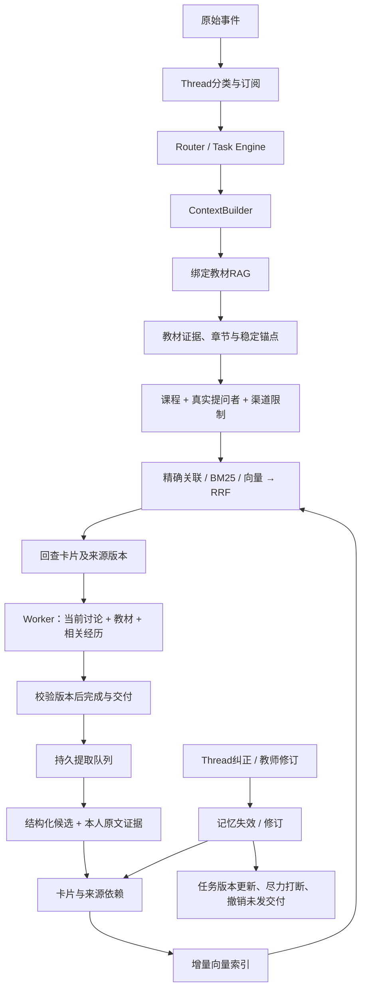

# 学习记忆与教材 RAG

日期：2026-11-03。

## 已实现范围

SQLite学习经历卡片、来源及依赖版本、持久提取队列、增量向量编码、限定范围的BM25/向量/RRF检索、教材知识点扩展查询、答疑上下文组装、教师查看/纠正/停用、thread纠正的同步失效与旧执行阻断。

新内核独立读取已导入教材。普通问题支持关键词、匹配配置时的向量召回及父块展开。明确题号优先读取 AI-chat 教材包中的 `references.json`，核对页文本哈希和原文跨度。原页图读取和主动多轮检索尚未接入。当前答疑预检索后进行一次模型调用。

批改、邮件和汇报Worker尚未实现，相应记忆入口待业务接入；本版自动写入来自已完成QA的学生发言。不建设跨渠道学生账号绑定。

## 架构



## 存储与身份

正式业务数据和原始事件提供事实来源；成绩、提交和评分标准通过精确业务查询读取。卡片记录观察、提供过的教学、后续表现、知识点、证据类型、真实作者、课程、渠道和时间。卡片教学内容保存回答前1800字符节选，完整回答仍在任务/交付记录中。向量绑定卡片版本及完整编码指纹，卡片修订后重新编码，索引本身不授予读取权限。

自动卡片标记为学生发言摘要，不自动升级教师确认或认定已经掌握。教师修订保留before/after审计。新偏好替代同渠道旧偏好，自动更新不覆盖教师确认的偏好；其他经历按时间保留，不能简单用最新表现覆盖全部历史。

学生主体使用课程内QQ用户ID。公开群答疑只读取本人在本群的公开经历；本人私聊可以读取该私聊和课程群内自己的公开经历，私人经历不进入群答疑。多人thread只加载当前被回复者的个人记忆，讨论保留真实作者。同名不自动将邮件批改记录带入QQ。

当前MemoryService只为QA提供个人经历；评分路径将来必须与个性化反馈分开。

## 检索与上下文

ContextBuilder从Run确定课程、真实提问者与任务渠道，Router不转述学生历史。先限定候选集合，再评分或编码。教材命中章节扩展记忆查询，教材父块锚点提供精确关联。关键词与向量用RRF融合，精确关联和有效偏好独立保留。

最多选6条记忆，独立10000字符预算；超预算整条省略并报告。教材最多4个证据块，父块最多5000字符；教材与记忆不竞争同一排名。命中卡片可通过管理接口回溯原文，教材保留命中页、父块页范围、印刷页码和视觉核验标识。

原文、记忆、检索结果均放在数据消息中，不进入系统指令层；记忆服务没有改成绩、权限或外发工具。读取后及提交前回查状态和版本，防止索引滞后造成旧结果生效。

## 更新与纠正

QA完成时，在提交结果的同一事务中为本轮新增学生发言生成持久提取任务。后台一次处理一个任务，不占QA Runner槽位；重放幂等，重启恢复中断任务。

模型输出至多4条候选。程序校验字段、长度、允许的偏好、教材锚点和逐字引用；至少一条引用来自该学生本人本轮消息。他人的“明白了”不能作为本人证据。全部讨论事件的归属版本一并保存为依赖，避免只跟踪引用句而漏掉语境。

失败任务保留错误，可由教师重试；来源过期时禁止重试旧任务，等待纠正后的讨论再次完成。Embedding后台逐卡回填，不在答疑路径临时编码全部历史；失败后30秒再尝试。未配置、配置不匹配或服务异常时使用关键词和精确关联，并报告实际模式及向量覆盖不足，不把检索分数解释为掌握概率。

Thread纠正与依赖卡片失效在同一事务完成；异步提取落库前检查来源、课程和任务版本。ContextBuilder调用模型前绑定所读卡片版本。教师修订、停用或来源纠正通过Task Engine更新受影响任务版本、撤销租约、尽力取消Worker并撤销未发交付。忽略取消信号的模型仍无法提交旧结果。已完成答复保留为历史版本，不自动重发；已发送或进行中的外部发送无法保证撤回。

## 配置与资料

```powershell
node scripts/import-textbook.ts '<已有教材包目录>' var/library
```

只复制白名单资料：manifest、chunks、pages、hierarchy、vectors、references、source.pdf；不复制聊天、账号、密钥或旧程序。校验已有PDF、子块与向量哈希，拒绝覆盖已存在目标。课程通过textbookIds绑定教材ID，未绑定时不读取其他课程资料。教材按ID缓存，替换后需重启新内核，不在运行中原地覆盖。

Embedding配置见.env.example。EMBEDDING_URL是兼容JSON embeddings协议的完整端点。导入向量仅在dimensions及manifest.embedding.configHash匹配时使用；操作员须保证实际端点与声明指纹一致，包括权重、pooling、EOS、模板及查询前缀。

## 管理API

全部需要ADMIN_TOKEN，QQ webhook令牌无权访问。

| 接口 | 用途 |
| --- | --- |
| GET /v1/courses/:id/memories | 最近200条课程记忆，含失效及停用记录 |
| GET /v1/memories/:id | 卡片、有效状态、原始消息 |
| PUT /v1/memories/:id | observation、outcome、topics及revision；标记教师确认 |
| POST /v1/memories/:id/retire | revision；停用并保留历史 |
| GET /v1/courses/:id/memory-jobs | 最近100个提取任务状态和错误 |
| POST /v1/memory-jobs/:id/retry | 重试来源仍有效的失败任务 |

桌面“学习记忆”页支持筛选、原文查看、纠正、停用及失败重试。

## 主要文件

- migrations/004-memory.sql：卡片、依赖、任务及向量。
- src/domain/memory.ts：记忆领域契约。
- src/adapters/storage/memory.ts：持久化、幂等、失效。
- src/application/memory-updater.ts：提取校验与增量编码。
- src/application/services/memory.ts：限权检索与教师管理。
- src/adapters/retrieval/hybrid.ts：共用BM25、余弦、RRF。
- src/adapters/knowledge/library.ts：独立教材读取检索。
- src/agents/context-builder.ts：上下文组装与记忆版本绑定。
- desktop/renderer/memory.js：教师管理界面。

测试覆盖跨thread、身份与渠道隔离、本人证据、偏好更新、真实向量召回及指纹不匹配、降级、教材父块/页范围、纠正与提取竞态、旧交付撤销、重启幂等和管理授权。程序路径验证不代表真实模型教学判断准确率，需用实际教师修订案例继续评估。
