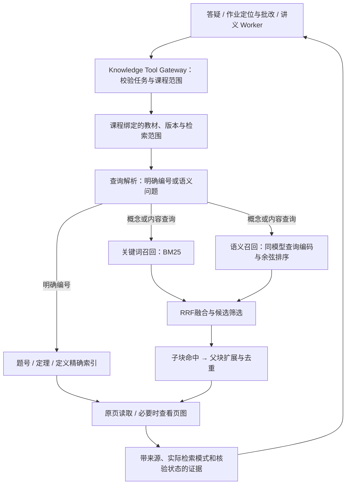

# 教材模块：RAG 混合检索

日期：2026-11-02。原始接入设计。2026-11-03已实现独立包读取、BM25/可选向量/RRF、父块扩展和QA上下文接入；编号精确索引、原页图读取仍待实现。当前实现及记忆联动见[memory-rag.md](memory-rag.md)。

## 1. 延续的技术路线

教材采用 RAG 混合检索，延续已使用的关键词、向量、融合及父子块路径。新系统独立实现领域接口与适配器；已有教材包可作为独立资料导入，不在运行时调用旧机器人。

已核对 AI-chat 本地的 `textbook-rag.ts`、`textbook-runtime.ts`、`textbook-references.ts` 与教材包 manifest。这说明本地代码和产物的情况，不代表已验证线上服务器的实际加载状态。

| 能力 | 本地现有实现/产物 | 新系统接入约束 |
| --- | --- | --- |
| 关键词召回 | 中文单字/双字及拉丁词项，BM25式评分 | 保留，支持数学术语、符号和编号定位 |
| 语义召回 | 查询向量与子块向量计算余弦相似度 | 查询编码必须匹配索引的模型与配置 |
| 融合 | RRF倒数排名融合，避免直接相加不同量纲分数 | 保留独立召回证据，不将分数当概率 |
| 父子块 | 检索子块，回溯父块并去重，补充跨页定义或证明 | 保留命中页与上下文页范围的区别 |
| 精确定位 | 独立编号索引支持习题、定理、定义等 | 明确编号优先查询索引，必要时辅助混合检索 |
| 页级核对 | 原页文本和PDF页图 | 公式/抽取异常时核对原件 |
| 降级 | 向量失败退回关键词；父子索引失败退回平面子块 | 必须报告实际模式和原因，不伪称混合检索成功 |

## 2. 已有教材数据

本地 `math-analysis-b3` 教材包的 manifest 记录：

- 书名：《数学分析讲义·第三册（程艺、陈卿等）》。
- PDF 共231页，737个子块，299个父块。
- 向量模型：`Qwen/Qwen3-Embedding-0.6B-Q8_0`，1024维。
- float32 little-endian、按子块顺序排列；记录了模型权重、子块和向量文件哈希。
- 查询指令、pooling、EOS和量化配置在manifest中保存。

旧运行时也支持BGE的512维索引。不能因都叫Embedding就混用两个向量空间，也不能只根据维数相同认定模型兼容。

迁移优先导入并验证已有产物，避免无理由重新切块或编码。只有源文件、切块、编码模型或编码配置发生变化时，才重建相应索引。

## 3. 运行路径



多轮追问以本任务讨论、已定位题目和必要历史构造查询，不拼接其他学生的独立任务内容。课程范围由服务绑定，Worker不能通过填写另一个课程ID扩大可读书库。

实际课程进度用于选择重点与解释范围；涉及前置知识时仍允许读取相关章节，不机械地将已讲页码之后的内容全部删除。

混合召回返回的是候选材料。明确题号查询保留母题条件与小问位置；不能将仅有相似解答的片段认定为同一道作业。

## 4. 接口与文件规划

| 位置 | 职责 |
| --- | --- |
| `src/ports/knowledge.ts` | 搜索、编号定位、原页读取、来源证据的独立契约 |
| `src/application/services/knowledge.ts` | 课程教材绑定、读取范围、实际模式与异常状态 |
| `src/tools/knowledge-tools.ts` | 向Worker提供限权搜索、定位和读取工具 |
| `src/adapters/knowledge/library.ts` | 组合具体教材包读取与检索实现 |
| `src/adapters/knowledge/package-reader.ts` | 读取manifest、页面、子块、哈希与版本 |
| `src/adapters/knowledge/lexical.ts` | 关键词召回与BM25评分 |
| `src/adapters/knowledge/vector.ts` | 子块向量读取、匹配的查询编码与余弦排序 |
| `src/adapters/knowledge/fusion.ts` | RRF融合，参数与算法版本显式保存 |
| `src/adapters/knowledge/hierarchy.ts` | 父块回溯、去重、上下文预算 |
| `src/adapters/knowledge/references.ts` | 编号索引及原文跨度校验 |
| `src/adapters/knowledge/embedding.ts` | 独立Embedding运行时；不复用旧bot进程 |
| `scripts/import-textbook.ts` | 导入已有教材包并输出校验报告 |
| `var/library/<book-id>/` | 独立教材数据目录，不提交Git |

以上为完整目标文件规划，并非已实现文件清单。当前QA已通过ContextBuilder接入教材；实际实现集中在src/adapters/knowledge/library.ts与src/adapters/retrieval/hybrid.ts。

教材包兼容目标：

```text
source.pdf
manifest.json
pages.json
chunks.json
vectors.bin
hierarchy.json
references.json
```

编号索引是单独能力，不能因为基础RAG可搜索就假定题号定位也已可用。缺失或损坏的可选索引应明确报告。

## 5. 证据与回答

检索结果至少记录：教材ID与版本、子块ID、命中PDF页、父块范围、原文、实际召回模式、各路排名、是否截断、是否需要视觉核对。

- PDF物理页码与印刷页码分别保存与展示。
- 扩展到父块后，不能把最强命中页误当成整个证明所在页。
- 预算不足时整块省略低排名父块，或返回明确的续读入口，避免默默截掉定理条件。
- 原文和检索结果始终是不可信数据，不能改变系统指令、评分标准或任务授权。
- 核验状态由实际读取/核对记录支持，不由模型一句“已核验”自行升级。

## 6. 接入验收

1. 明确术语、同义改写、题号和定理编号均有覆盖案例。
2. 可观察关键词、向量和融合排序；测试实际运行了两路召回，而不只检查返回值标签。
3. 用现有索引对应的模型对查询和样本子块复核编码配置。
4. 原文引用可回到正确教材和实际PDF页，跨页与父子块关系正确。
5. 向量不可用、哈希变化、编号歧义时报告真实状态，不选错教材或静默伪装成功。
6. 从QQ答疑和批改任务调用时，只访问绑定课程允许的资料。
