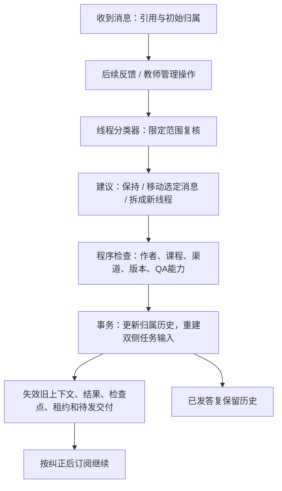

# 可修正的 Thread 分类

状态：已实现版本化归属、受控迁移、反馈复核和管理 API；尚未连接真实模型评估分类准确率。

## 原则与路径

Thread 分类是可修订的判断。明确引用是强关联线索，但也可能引用错误；后续反馈可以推翻早先分类。

原始消息、作者、来源和接收时间保持不变。`event_threads` 保存当前归属和版本，`thread_changes` 保存旧归属、新归属、反馈来源、原因及受影响任务。`Store.originalEvent` 返回原始事件，`Store.event` 返回当前归属视图。



## 修改语义与权限

- 移动选定消息到同课程、同渠道的其他线程；不指定目标时建立新线程。
- 移动多条消息可实现局部拆分或合并，不自动搬动未选中的其他追问。一次最多20条。
- 源消息和目标锚点均携带归属版本，过期建议被拒绝。
- 学生反馈只能作为纠正自己消息的依据；教师可以纠正该范围内他人的消息。
- 分类器只重建QA上下文，不修改讲义、批改、评分标准、教师目标、身份或授权。涉及非QA任务的输入，当前通道拒绝迁移。

## 事务与恢复

1. 更新归属与历史，并更新被移动原消息的引用映射。
2. 从旧任务输入移除消息，加入目标QA任务；消息仍按原接收顺序提供给Worker。
3. 增加双侧任务版本和输入版本，清除旧上下文产生的结果与检查点。
4. 旧执行结果不能提交；尽力取消旧调用；未发送的旧答复标为withdrawn。
5. 暂停任务保持暂停，取消任务不恢复。
6. 根消息移走时旧QA任务变为superseded，剩余讨论重新路由，避免继续沿用旧目标与授权。
7. 新线程没有任务时按正常Router路径建一个独立任务，多条追问汇入该任务。

`superseded` 表示讨论结构变化后被替代，不允许恢复旧上下文。

已发或发送中的答复无法承诺撤回，保留原交付和发送时线程快照。旧答复的引用映射不随原提问迁移而悄悄跳到新线程；原提问自己的映射按新归属更新。首版不自动发布公开更正消息。

## 自动反馈复核

配置模型并设置 `THREAD_RECLASSIFY_ENABLED=true` 后，含“串台”“我问的是”“不是……题”“另一个问题”等线索的学生消息先进入持久复核队列，不立即送到答疑Worker。

这些文字仅触发复核，不直接修改。模型读取同课程同渠道最近最多60条消息，输出严格的keep或move建议。move必须包含反馈消息，其他移动消息需有证据并属于可移动范围；Engine再次检查权限和版本。无法确定时keep，反馈返回普通答疑。

分类期间若候选归属已变化，拒绝迟到建议并记录错误。模型失败不宣称已纠正。当前不对所有普通消息全量重分类；未命中线索的情况可由教师显式发起复核。迁移前已经发出的答复无法被未来判断追溯撤销。

## 管理 API

均使用ADMIN_TOKEN，QQ接入令牌不能调用。

- `GET /v1/threads`：最近100条消息的当前归属、版本、正文和真实作者。
- `GET /v1/threads/changes`：最近100条修订历史。
- `POST /v1/events/<反馈事件ID>/reconsider`：以原反馈作者的范围发起模型复核，不提升作者权限。
- `POST /v1/threads/reclassify`：教师明确指定移动，记录管理员身份与原因。

```json
{
  "moves": [{ "eventId": "待移动消息ID", "revision": 1 }],
  "targetEventId": "正确讨论中未移动的锚点消息ID",
  "targetRevision": 1,
  "reason": "后续反馈证实这条消息在询问第3题"
}
```

省略targetEventId和targetRevision时新建线程。版本冲突返回409；越权、跨课程、跨渠道或涉及非QA任务返回403。

## 实现位置

- `src/agents/thread-classifier.ts`：模型复核与建议。
- `src/application/task-engine.ts`：reclassify事务与任务失效。
- `src/adapters/storage/sqlite.ts`：原始事件、当前视图及历史。
- `migrations/002-thread-revisions.sql`：为已有事件补初始归属，不覆盖原数据。
- `tests/thread-reclassification.test.ts`：拆分、合并、权限、旧结果和历史映射验证。
